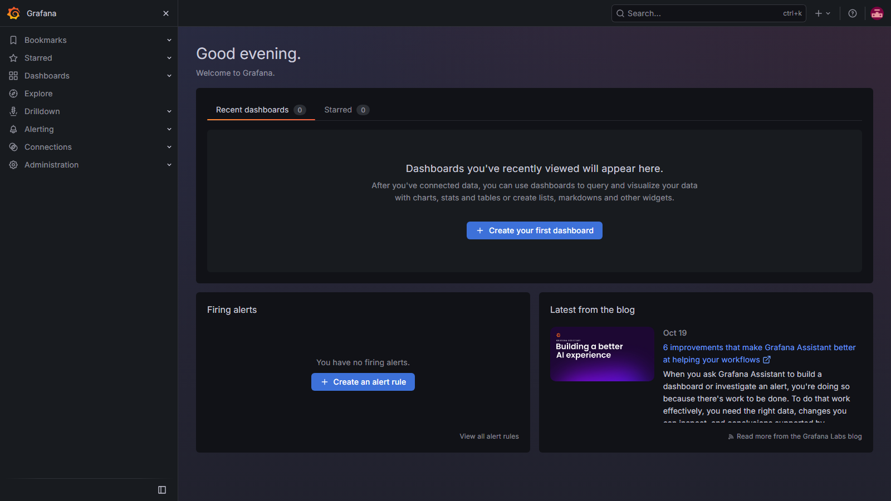
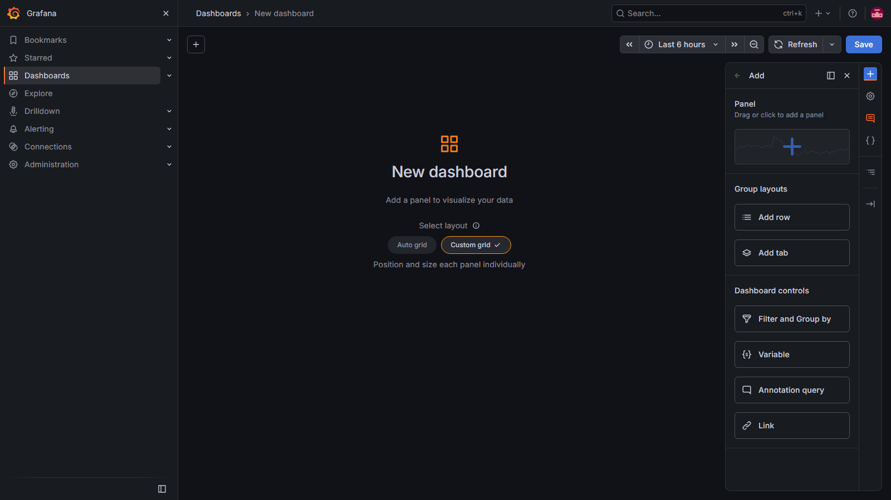
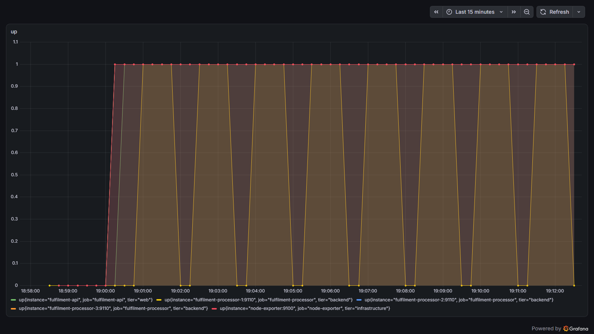
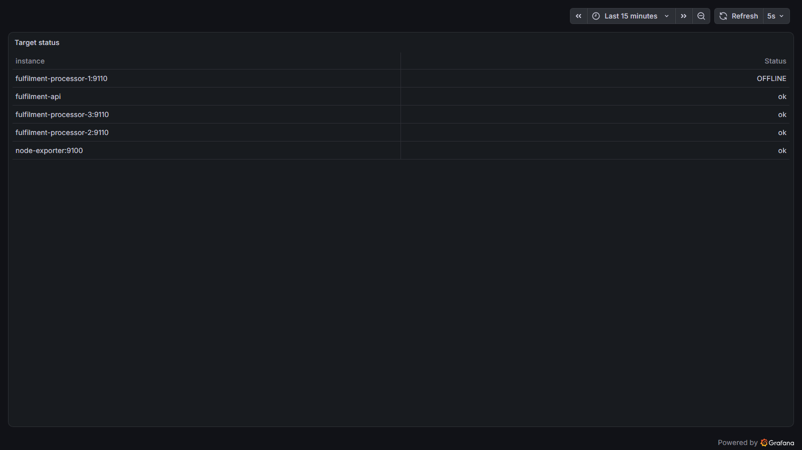
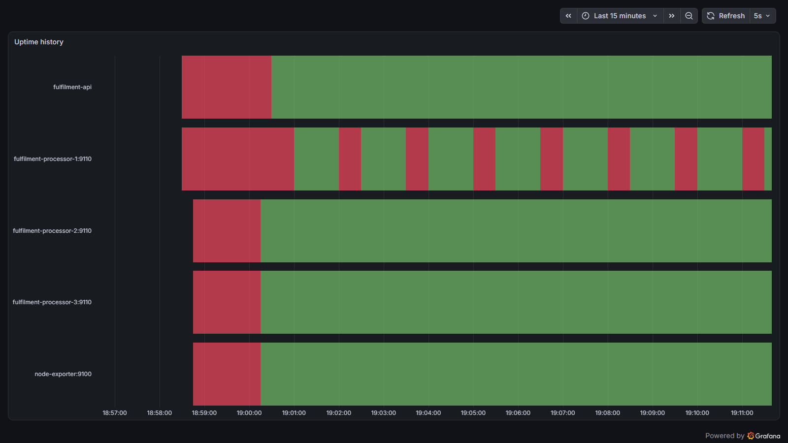
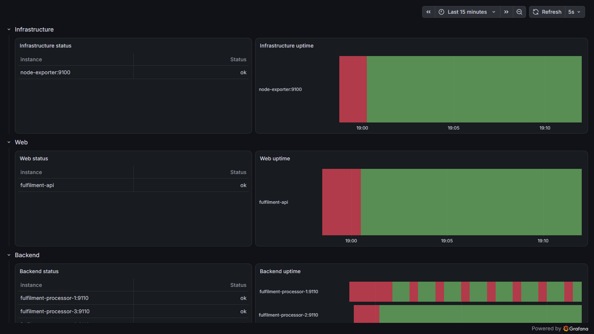

# Grafana

[Grafana](https://grafana.com/oss/grafana/), veriyi görselleştirmek için web
tabanlı bir arayüz. Çok farklı kaynaktan veri tüketebiliyor ve özellikle
Prometheus ile iyi eşleşiyor. Sorgularınızı ince ayar yapmak için Prometheus
arayüzünü kullanıp, sonra PromQL'i alıp Grafana'da kullanabilirsiniz.

> Bu lab'daki ekran görüntüleri de yazılı adımlar da container'ların
> çalıştırdığı sürümde, Grafana 13.2.4'te alındı. Menü etiketleri Grafana
> sürümleri arasında yer değiştirebiliyor — bir şey yine kaymışsa
> [Grafana dökümanları](https://grafana.com/docs/grafana/latest/) bağlayıcıdır.

<!-- orientation:auto -->
## Bu lab nasıl işliyor

Bunu bir kez okuyun - bu eğitimdeki her lab aynı kurallarla yazıldı.

**Komutları nereye yazacaksınız.** Bir terminal açın ve bu depoyu kopyaladığınız
klasöre gidin. Windows'ta **PowerShell** kullanın (Başlat menüsünde aratın),
macOS veya Linux'ta **Terminal**. Labdaki bütün yollar depo kökünden yazıldı,
yani bir adım aksini söylemedikçe orada kalın.

**`>` ile başlayan satırlar açıklamadır, komut değildir.** Onları yapıştırmayın.
Yalnızca gri kod kutularının içindeki metin yazılır.

**📋 işareti "sıra sizde" demektir.** Onu gördüğünüzde adımı önce kendiniz
deneyin. Hemen altında cevabı saklayan kapalı bir **"Nasıl yapılır?"** oku var;
onu denedikten *sonra* açın, önce değil. Lablar bilerek böyle yazıldı: kendi
çözdüğünüz şeyi hatırlarsınız, yapıştırdığınızı değil.

**Bir komut hata verirse bu normal olabilir.** Bazı adımlar hatanın nasıl
göründüğünü göstermek için bilerek başarısız olur. Bir şeyin bozuk olduğuna
karar vermeden önce komutun üstündeki cümleyi okuyun.

**Takılırsanız** şu sırayla:

1. Komutun üstündeki paragrafı tekrar okuyun - cevap genelde oradadır.
2. **"Nasıl yapılır?"** okunu açın.
3. `hints.md` dosyasını açın, küçük bir yönlendirme verir.
4. `solution.md` dosyasını açın, tam cevap orada. Kullanmak serbest; okumadan
   kopyalamak değil.

**Bitirdiğinizde** en alttaki **Temizlik** bölümünü çalıştırın. Lablar aynı
portları ve container adlarını paylaşıyor; birinden kalan artık diğerini bozar.
<!-- /orientation:auto -->

<!-- prereqs:auto -->
## Başlamadan önce

Süre: yaklaşık 40 dakika.

**Docker Desktop** çalışıyor olmalı. Kontrol edin:

```
docker version
```

Çıktıda bir `Server:` bölümü görüyorsanız hazırsınız. Onun yerine hata
alıyorsanız Docker Desktop'ı başlatın ve balina simgesi hareket etmeyi
bırakana kadar bekleyin.

> Bütün komutları **deponun kök dizininden** çalıştırın; bu labdaki yollar ona göre yazıldı.

## Kaynaklar

- [Prometheus'u veri kaynağı olarak kullanmak](https://grafana.com/docs/grafana/latest/datasources/prometheus/)
- [Panel'ler](https://grafana.com/docs/grafana/latest/panels/) — tek tek sorgu
  görselleştirmeleri
- [Dashboard'lar](https://grafana.com/docs/grafana/latest/panels/add-a-panel/) —
  birden fazla paneli birleştirmek

## Grafana'yı çalıştırmak

Grafana, Go ile yazılmış çok platformlu bir uygulama. Farklı platformlar için
[Grafana'yı indirebilirsiniz](https://grafana.com/grafana/download?pg=get&plcmt=selfmanaged-box1-cta1)
ama biz Docker container'ında çalıştıracağız:

- [grafana.yml](./grafana.yml) — Prometheus ve Grafana container'larını
  tanımlıyor
- [prometheus.yml](./config/prometheus.yml) — kullanacağımız Prometheus
  yapılandırması; çeşitli uygulamalar için veri toplamayı kuruyor ve `tier`
  etiketini ekliyor

Metrik bileşenlerini çalıştırın:

```
docker compose -f labs/grafana/grafana.yml up -d
```

> Prometheus durumunu http://localhost:9090/targets adresinde kontrol edin

Tüm hedeflerin kapalı olduğunu göreceksiniz, ama `tier` etiketi `instance` ve
`job` ile birlikte ayarlanmış durumda. Hedef etiketlerine bu şekilde
altyapıya özgü ayrıntılar ekleyebilirsiniz; bulut servisleri için bölgeyi, ya
da işletim sistemi ve CPU mimarisini dahil edebilirsiniz.

> Grafana'yı http://localhost:3000 adresinde açın

Varsayılan kimlik bilgileriyle giriş yapın — yeni parola oluşturmanız
istenecek ama bu adımı atlayabilirsiniz:

- kullanıcı: `admin`
- parola: `admin`

Güncel Grafana'da veri kaynağını **Connections > Data sources** üzerinden
eklersiniz:



📋 `http://prometheus:9090` URL'siyle bir Prometheus veri kaynağı ekleyip test
edin.

<details>
  <summary>Biraz yardım lazım mı?</summary>

Sol menüden **Connections > Data sources** bölümünü açıp _Add new data source_
tıklayın (ya da doğrudan
http://localhost:3000/connections/datasources/new adresine gidin).

- Veri kaynağı tipi olarak Prometheus seçin
- _Prometheus server URL_ alanına `http://prometheus:9090` yazın
- Diğer tüm alanları olduğu gibi bırakın

> _Save & test_ tıklayın ve _Data source is working_ mesajını göreceksiniz.

</details><br/>

Kurulum için gereken bu kadar — artık Prometheus'u sorgulayan panellerle bir
dashboard oluşturabilirsiniz.

## Uptime paneli oluşturmak

Sol menüden **Dashboards**, sonra **New > New dashboard** yolunu açın. Şuna
benzer boş bir dashboard göreceksiniz:



Her görselleştirme, bir dashboard içindeki bir paneldir.

📋 `up` metriğini kullanarak Prometheus hedeflerinin ayakta olma durumunu
gösteren yeni bir panel ekleyin.

<details>
  <summary>Biraz yardım lazım mı?</summary>

Boş dashboard sizden _Select layout_ seçmenizi ister - _Auto grid_ ya da
_Custom grid_ seçin, sonra _Add_ tıklayıp _Panel_ deyin. (Grafana 13, eski
_+ Add visualization_ düğmesini bu düzen seçiciyle değiştirdi.) Panel
düzenleyici varsayılan veri kaynağınızla açılır; sorgu düzenleyicisine `up`
yazın. Görselleştirmenin bir ön izlemesini göreceksiniz; tam istediğimiz
gibi değil:



</details><br/>

Panel tasarımcısı üç bölümden oluşuyor:

- üstte görselleştirme ön izlemesi
- altta veri; sorgu ve dönüşümler (transform) dahil
- sağda görüntüleme seçenekleri; görselleştirme tipi dahil

Varsayılan, Prometheus'tan gelen bir aralık vektörünü temsil eden _Time
series_ görselleştirmesini kullanmak.

Şimdi yolunuzu bulma zamanı :)

📋 Panel ayarlarını, Grafana'nın bunu anlık vektör gösteren bir tablo olarak
ele alacağı ve tablo görselleştirmesi kullanacağı şekilde değiştirin. Tabloyu,
yalnızca instance adı ve durum alanları görünecek biçimde kurun; ayakta olan
instance'lar için `ok`, diğerleri için `OFFLINE` göstersin.

Hedeflediğiniz şey bu:



<details>
  <summary>Biraz yardım lazım mı?</summary>

_Query_ bölümünde:

- _Format_ değerini Table yapın
- _Type_ değerini Instant yapın

> Grafana 13'te bunlar sorgu satırındaki _Options_ altında. _Instant_ eskiden
> bir onay kutusuydu; artık iki _Type_ seçeneğinden biri (Range ya da
> Instant).

Görüntüleme seçeneklerinde:

- tipi Table olarak değiştirin

_Transformations_ sekmesinde (_Query_ sekmesinin yanında):

- _Organize fields by name_ seçin
    - instance ve value dışındaki her şeyi gizleyin
    - value adını Status olarak değiştirin

Görüntüleme seçeneklerine dönün:

- Bir başlık ekleyin

- _Value mappings_ bölümüne inip _Add value mappings_ tıklayın (eşleme
  eklediğinizde düğme _Edit value mappings_ olur)
    - value=0 için `OFFLINE` gösteren bir eşleme ekleyin
    - value=1 için `ok` gösteren bir eşleme ekleyin
    - _Apply_ tıklayın

Panelinizi güncelleyip dashboard'a dönmek için sağ üstteki _Back_ tıklayın,
sonra saklamak için _Save_. (Eski Grafana'da bu düğmeler _Back to dashboard_
ve _Save dashboard_ adını taşıyordu.)

</details><br/>

Grafana dashboard'ları otomatik yenilenecek şekilde ayarlanabiliyor. 5
saniyede bir yenilemeyi seçin (dashboard'ın sağ üstü); böylece uygulamaları
başlattığımızda devreye girdikçe tablonun güncellendiğini göreceksiniz.

## Görselleştirme Tipleri

Prometheus'un toplayacak metriği olsun diye uygulamaları başlatın:

- [apps.yml](./apps.yml) — node exporter'ı, döküman API'sini ve üç döküman
  işleyiciyi tanımlıyor; işleyicilerden biri sürekli çıkıp yeniden başlayacak
  şekilde yapılandırılmış.

Uygulamaları çalıştırın:

```
docker compose -f labs/grafana/apps.yml up -d
```

> Grafana'ya geri dönün — instance'lar devreye girdikçe tablonun
> güncellendiğini göreceksiniz.

Yeterince uzun izlerseniz 1 numaralı işleyici instance'ının `ok` ve `OFFLINE`
arasında gidip geldiğini göreceksiniz. Elimizdeki tablo güncel durumu
gösteriyor; her bileşenin uptime geçmişini görmek de faydalı olurdu.

Üst menüden _Add_ tıklayıp ikinci bir panel eklemek için _Panel_ seçin.

Geçen sefer etiketleri gizlemek için bir dönüşüm kullandık, ama bunu sorguda
da yapabiliriz:

- sorguyu `sum without(job, tier) (up)` yapın
- görselleştirme tipini _State timeline_ olarak değiştirin
- 0'ı `OFFLINE`, 1'i `ok` gösteren aynı değer eşlemesini ekleyin
- zaman aralığını (örneğin) son 15 dakika yapın

Yaklaşıyoruz, biraz toparlamak kaldı.

📋 Sorgu ve görüntüleme seçeneklerini, y ekseninin açıklaması daha faydalı
olacak, x ekseni açıklaması gizlenecek ve `OFFLINE` kırmızı, `ok` yeşil çubuk
olarak görünecek şekilde düzenleyin.

Hedef bu:



<details>
  <summary>Biraz yardım lazım mı?</summary>

Görüntüleme seçeneklerinde:

- bir panel başlığı ekleyin

- _Legend_ bölümüne inin
    - _Legend mode_ değerini _Hidden_ yapın

- _Thresholds_ bölümüne inin
    - taban değerin rengini kırmızı yapın
    - sonraki eşiği 1 ve rengini yeşil yapın

Sorgu bölümünde:

- legend biçimini `{{instance}}` yapın

_Back_ tıklayın.

</details><br/>

Böyle daha iyi — dashboard artık tüm instance'lar için güncel ve geçmiş
durumu gösteriyor. 1 numaralı işleyicide tekrarlayan bir sorun olduğunu
görebiliyoruz; bu, yalnızca tablodan anlaşılmıyordu.


## Gerçek Bir Dashboard

Grafana ile çalışmak zahmetli olabiliyor — ama dashboard'ınızı bir kez
tasarladığınızda onu herhangi bir Grafana sunucusuna yükleyebilirsiniz.

Lab'da özel bir dashboard ile devam edeceğiz, ama gerçek bir dashboard'ın
nasıl göründüğünü görmeniz için `labs/grafana/dashboards/app.json` dosyasında
hazır bir tane var:

- sol menüden **Dashboards**, sonra **New > Import** yolunu açın
- _Upload dashboard JSON file_ tıklayıp `app.json` dosyasının yolunu bulun
- sorulursa Prometheus veri kaynağınızı seçin, sonra _Import_ tıklayın

Bu görselleştirmelerin tamamı, çalıştırdığınız container uygulamalarından
gelen metriklerle besleniyor. Sağ üstteki açılır listeden zaman ölçeğini
düşürüp son 30 dakikanın metriklerini göstererek Grafana'nın eğilimleri nasıl
gösterdiğini görebilirsiniz.

## Lab

Uygulamalarınız için farklı seviyelerde bilgi gösteren birkaç dashboard'ınız
olacak.

Bu lab'da instance uptime'ında kalacağız, ama göreviniz dashboard'ı
uygulamanın her katmanı için bir tane olmak üzere birden fazla satıra (row)
bölmek:

- node exporter instance'ını içeren bir altyapı satırı
- döküman API instance'ını içeren bir web satırı
- işleyici instance'larını içeren bir backend satırı

Her satırda o katmandaki instance'lar için bir güncel durum tablosu ve bir
zaman çizelgesi olmalı; şuna benzer:



Dashboard'ınızı JSON olarak kaydedin; böylece sonra başka bir Grafana
örneğine yükleyebilirsiniz.

> Takıldınız mı? [İpuçlarına](hints.tr.md) bakın veya
> [çözümü](solution.tr.md) inceleyin.

___
<!-- troubleshooting:auto -->
## Takılırsanız

**`Cannot connect to the Docker daemon`** - Docker Desktop çalışmıyor.
Başlatın ve balina simgesi hareket etmeyi bırakana kadar bekleyin.

**`port is already allocated`** - önceki bir labdan kalan konteyner o portu
hâlâ tutuyor. `docker ps` ile neyin çalıştığına bakın, eskisini
`docker rm -f <ad>` ile kaldırın.

**`The container name "/..." is already in use`** - aynı sebep, aynı çözüm:
`docker rm -f <ad>` deyip komutu tekrar çalıştırın.

**Build sırasında `unable to prepare context: path ... not found`** - yanlış
dizindesiniz. Bu labdaki her komut deponun kök dizininde olduğunuzu varsayıyor.

**Çalışmak yerine kullanım metni basan `docker run`** - bu labdaki bazı
komutlar, yanlış argümanın nasıl göründüğünü göstermek için kasıtlı olarak
başarısız oluyor. Bozuk sanmadan önce komutun çevresindeki açıklamayı okuyun.

Hâlâ takılıysanız: aşağıdaki **Cleanup** bölümü her şeyi sıfırlıyor, labı
temiz bir makineyle baştan yapabilirsiniz.


## Temizlik

Bu lab'ın container'larını kaldırın:

```
docker compose -f labs/grafana/grafana.yml down
docker compose -f labs/grafana/apps.yml down
```

> Bu komut yalnızca bu lab'in baslattigi container'lari kaldırır. Tamamen
> temiz bir başlangıç istiyorsanız `docker ps` ile hâlâ çalışan varsa
> görebilirsiniz.
