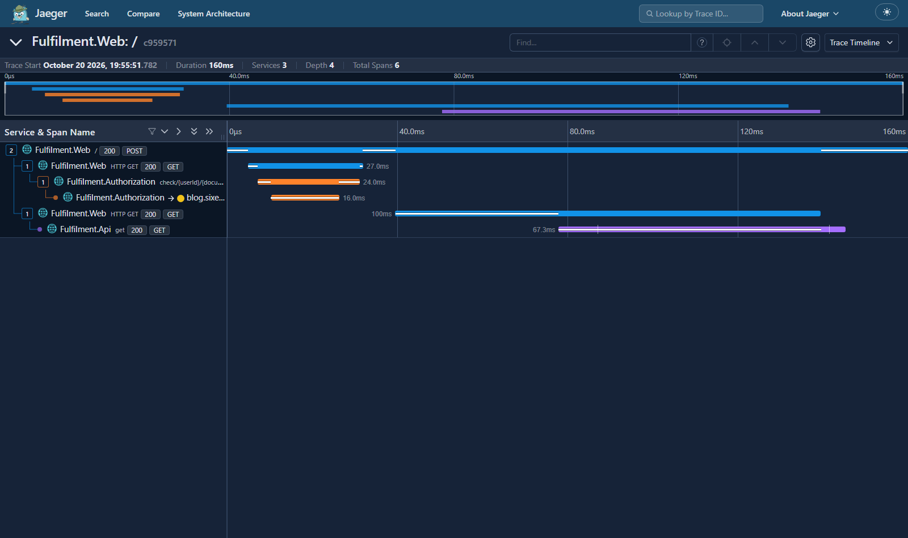

# Running Jaeger

[Jaeger](https://www.jaegertracing.io) is a distributed tracing system - it collects and stores traces, and gives you a web UI to find and visualize them. Jaeger originally used its own data format, but it also supports OpenTelemetry - and Jaeger 2 is built *on* the OpenTelemetry Collector.

You can run Jaeger in a production configuration with different features running in different processes, swapping out the data store or adding a message queue to buffer collection. 

## Reference

- [Jaeger architecture](https://www.jaegertracing.io/docs/latest/architecture/) - mapping to OpenTelemetry terminology

- [Getting started with Jaeger](https://www.jaegertracing.io/docs/latest/getting-started/)

- [Instrumenting apps with OpenTelemetry](https://opentelemetry.io/docs/concepts/instrumentation/) - which can be collected by Jaeger

## Run Jaeger

We'll run a simple configuration of Jaeger, where all the components run in a single Docker container:

- [jaeger.yml](./jaeger.yml) - specifies a Jaeger container, connected to a tracing network and publishing port 16686, the default web UI port

Run Jaeger:

```
docker compose -f labs/jaeger/jaeger.yml up -d
```

Browse to the Jaeger UI at http://localhost:16686 and hit the _Search_ menu at
the top. This is where you find traces: the _Service_ dropdown lists every
service which has sent spans to Jaeger, and the _Operation_ dropdown lists the
named operations within them.

Right now the list is empty, because nothing has sent Jaeger any spans yet.

> Older versions of this lab started here by looking at Jaeger's own
> `jaeger-query` traces. Jaeger 2 reports far less about itself: on a fresh
> container the service list is genuinely empty, and a `jaeger` service only
> appears once real spans are flowing. So there is nothing to look at until
> we send it some - we'll do that next.

Jaeger accepts spans in several formats. Its default configuration enables
receivers for OTLP (the OpenTelemetry protocol), the legacy Jaeger protocols
and Zipkin - so apps instrumented with any of those can report to it without
extra configuration.

## Exporting traces to Jaeger

The demo application we'll use has three components which are all set up with distributed tracing with OpenTelemetry:

- [apps.yml](./apps.yml) - specifies containers for the web application, document service API and an authorization service API. They're all configured to send trace spans to the Jaeger container.

Run the application containers:

```
docker compose -f labs/jaeger/apps.yml up -d
```

Browse to the home page for the web UI at http://localhost:8070, and then refresh your Jaeger search at http://localhost:16686/search.

> You should see `Fulfilment.Web` in the service list now.

📋 Open the trace for the homepage request to the web application. How many spans are in this trace?

<details>
  <summary>Need some help?</summary>

In the search UI set the _Service_ to `Fulfilment.Web` and the _Operation_ to `/`. Click _Find Traces_ and you should see a single result.

Open that trace and expand the details. There's just one span which is the server response to your browser request.

</details><br/>

Traces are compiled from the spans Jaeger collects. There's no advance detail of what to expect from which service, it's all built retrospectively from whichever spans made it to Jaeger.

A trace with a single span is perfectly valid - it means there were no other HTTP requests in the call chain.

Now browse back to the [document list page](http://localhost:8070/) and hit _Go_, using the default value for the user field.

📋 Find the trace for your new request. Does this have more spans?

<details>
  <summary>Need some help?</summary>

In Jaeger search you'll see a lot more services. We still want `Fulfilment.Web` but it's not always clear which operation you want, so you can select _all_ for the operation and hit _Find Traces_.

The one you want is listed with multiple spans from multiple services.

</details><br/>

Open the trace and expand the details, and you'll see the real value of adding tracing to your apps:



The graph at the top shows the total trace duration, and within that the duration for each span. In this example the whole request took 1.01 seconds, and you can clearly see the web app makes two consecutive HTTP calls.

Below the graph you get the details of each span, which you can expand to see
the tags and any additional information.

Tags are key-value pairs you set in your spans to record extra detail. Some are
conventional and you'll see them across components (`http.method`,
`http.status_code`, `span.kind`), but the collection is arbitrary - you can add
whatever is useful.

The trace timeline is the most useful view, but you can switch to others from
the dropdown at the top right:

- _Trace Statistics_ - low-level timing details about the spans
- _Trace JSON_ - the full raw data

📋 What is the call trace when you got the document list - and which part of the call takes the most time?

<details>
  <summary>Need some help?</summary>

Expand all the spans and you'll see a lot of detail:

- the web app receives a POST request from the user clicking the button
    - this is the topmost span, which is a server response to the client

- the web app calls the authorization service
    - there are two spans here because both components capture traces - the client call from the web app, and the server response from the authorization service

- the authorization service calls an external web address (my blog, actually)
    - just a single span here, the client call from the authorization service, because we don't get trace details from the blog server

- the web app calls the document service
    - two spans again here as both components record trace spans, the client call from the web server and the server call from the API server

Which span dominates depends on the day. The call you do **not** control is
the external request to https://blog.sixeyed.com - when these labs were
written it was by far the slowest, at about a second. It is cached behind a
CDN now and often comes back in milliseconds, in which case the call to the
document API is the longest. That variability is exactly why the external
dependency is the one worth watching.

</details><br/>

The application components use OpenTelemetry libraries to record and send trace spans for incoming and outgoing HTTP calls. They're using different technologies (ASP.NET and Spring Boot), but the tracing format is the same so Jaeger can compile all the spans into the correct trace.

None of the apps required any extra code to collect and send traces, other than wiring in the instrumentation library:

- for the .NET app that's done in the `AddTracing` extension method in the [Tracing](https://github.com/courselabs/fulfilment/blob/main/src/fulfilment-frontend/Fulfilment.Core/Services/Tracing.cs#L11) class

- for the Spring Boot app it's done without code by using the `opentracing-spring-jaeger-web-starter` package, referenced in [pom.xml](https://github.com/courselabs/fulfilment/blob/main/src/fulfilment-api/pom.xml#L42)

## Lab

Distributed tracing is great for exploring the internal structure of features in an unfamiliar app. 

Browse to the [Submit document](http://localhost:8070/Submit) page on the web app and click _Go_ using the default field values on the page.

Use Jaeger to plot the call stack for submitting documents; which method on which class actually creates the document?

> Stuck? Try [hints](hints.md) or check the [solution](solution.md).

___
## Cleanup

Clean up by removing this lab's containers:

```
docker compose -f labs/jaeger/jaeger.yml down
docker compose -f labs/jaeger/apps.yml down
```

> This removes only the containers this lab started. If you want
> a clean slate, `docker ps` will show anything still running.
