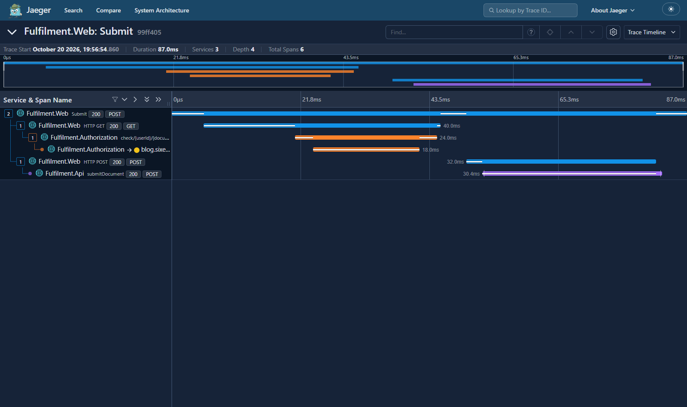

# Lab Çözümü

İziniz şuna benzer görünecek:



Çağrı yığını şöyle:

- web uygulaması http://localhost:8070/Submit adresinde bir POST isteği alıyor
  — bu, kullanıcının _Go_ düğmesine basmasından geliyor; fazladan ayrıntı yok
  çünkü bilgi, izlenmeyen istek gövdesinde

- web uygulaması yetkilendirme servisine
  http://fulfilment-authz/check/0421/Submit adresinde bir GET isteği yapıyor —
  bunun, 0421 ID'li kullanıcının döküman gönderme izni olup olmadığını
  kontrol ettiğini tahmin edebilirsiniz

- yetkilendirme servisi https://blog.sixeyed.com adresine bir GET isteği
  yapıyor — bu hiç mantıklı değil; gerçek bir uygulamada bu, harici bir kimlik
  servisine çağrı olabilirdi

- web uygulaması döküman servisine http://fulfilment-api/document adresinde
  bir POST isteği yapıyor — döküman göndermenin asıl isteği bu

Son döküman API span'i, etiketlerin yanında birkaç log kaydı da içeriyor. Log
özellikleri sınıfın ve metodun adını söylüyor:

```
handler.class_simple_name = DocumentsController	
handler.method_name	= submitDocument
```
___
> [Alıştırmalara](README.tr.md) dönün.
