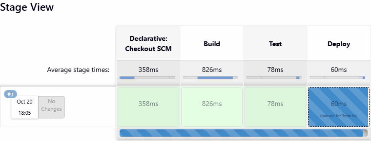

# Automation with Jenkins

[Jenkins](https://jenkins.io) is probably the most widely used automation
server around — widely used rather than widely loved. It has been going a long
time and its main feature is extensibility: a plugin framework with more than
1,800 published plugins, so it can build any kind of application and integrate
with any third-party system. There's a web UI for defining jobs, and those job
definitions get stored on the server's filesystem.

The UI and the plugins are also the main reasons people dislike Jenkins.
Plugins are a recurring source of security advisories so they need frequent
updates, and they're fiddly to automate. You often find Jenkins servers kept
alive long past their retirement date, because nobody is confident they could
recreate the exact set of plugins and reload the job definitions on a new
server.

We'll use Jenkins the other way round: **minimal plugins, job definitions in
source control.**

<!-- prereqs:auto -->
## Before you start

Takes about 45 minutes.

**Docker Desktop** must be running. Check it:

```
docker version
```

A `Server:` section in the output means you are ready. If you get an error
instead, start Docker Desktop and wait until the whale icon stops animating.

> Run every command from the **root of this repository** - the paths in this lab are written relative to it.

## Reference

- [Jenkinsfile walkthrough](https://www.jenkins.io/doc/book/pipeline/jenkinsfile/)
- [Declarative Pipeline syntax](https://www.jenkins.io/doc/book/pipeline/syntax/)
- [Pipeline steps reference](https://www.jenkins.io/doc/pipeline/steps/)
- [Configuration as Code (JCasC)](https://www.jenkins.io/projects/jcasc/)

## Running Jenkins

Start Jenkins and a local Git server ([Gitea](https://about.gitea.com)):

```
docker compose -f labs/jenkins/infra/docker-compose.yml up -d
```

> The Jenkins image is [built from this Dockerfile](../../images/jenkins/Dockerfile).
> The plugins and the admin user are baked in with
> [Configuration as Code](../../images/jenkins/casc.yaml), so there's no setup
> wizard and no `initialAdminPassword` to dig out of the logs.

Check both containers are running:

```
docker compose -f labs/jenkins/infra/docker-compose.yml ps
```

### Set up the Git server

Gitea starts with an empty database, so create a user for yourself:

```
docker compose -f labs/jenkins/infra/docker-compose.yml exec -u git gitea gitea admin user create --admin --username student --password student --email student@labs.local --must-change-password=false
```

> `--must-change-password=false` matters: without it Gitea forces a password
> change at first login, which breaks the Jenkins credentials later in the lab.

Browse to Gitea at http://localhost:3000 and sign in with `student` / `student`.

### Sign in to Jenkins

Browse to http://localhost:8080. It may take a minute on first start — Jenkins
is loading its plugins. Sign in with:

- username: `student`
- password: `student`

Have a look around. It's resolutely "web 1.0". The left nav has the main
options including _Manage Jenkins_; the middle of the page lists your jobs once
you have some.

## Creating a Freestyle Job

Let's start with a classic Jenkins job — the *freestyle* type, where you build
the steps up in the web UI:

- click _Create a job_ on the home screen
- name it `lab-1`
- choose _Freestyle project_
- click _OK_

The config page has sections for the typical parts of a build: source code,
build triggers, build steps.

We'll run a simple script that prints some text:

- scroll to the _Build Steps_ section
- click _Add build step_
- select _Execute shell_
- paste this into the _Command_ box:

```
echo "This is build number: $BUILD_NUMBER of job: $JOB_NAME"
```

- click _Save_

> Jenkins sets [a bunch of environment variables](http://localhost:8080/env-vars.html/)
> when it runs a job, and your steps can read them. This script prints the build
> number — which increments every run — and the job name.

You're now on the job page. The left nav lets you reconfigure it; the middle
shows recent runs.

Click _Build Now_. When it finishes, check the output at
http://localhost:8080/job/lab-1/1/console

📋 Run the job again — how is the output different?

<details>
  <summary>Not sure?</summary>

Click _Build Now_ again. When it completes the output is at
http://localhost:8080/job/lab-1/2/console

The job name is the same; the build number has incremented.

</details><br/>

This Jenkins server has other tools installed, the kind you'd use in a real
pipeline. What happens if you print their versions?

📋 Edit the job to print the versions of `javac` and `docker`, and then to list
Kubernetes nodes with `kubectl get nodes`.

<details>
  <summary>Not sure how?</summary>

Click _Configure_ on the job page. Update the _Command_ box:

```
javac --version

docker version

kubectl get nodes
```

Click _Save_, then _Build Now_.

</details><br/>

The build **fails**. Shell commands return an exit code: 0 means success,
anything else means failure. `javac` and `docker` work — the Docker CLI is in
the image and the container has the host's Docker socket mounted. But
`kubectl get nodes` has no cluster to talk to, so it exits non-zero, and
Jenkins marks the step as failed.

If there were more steps after this one they would not run: the job stops at
the first failure.

> So where does this job definition actually live? On the Jenkins server's
> filesystem. How would you move it to a new server? How would you review a
> change to it? This is why we use [pipelines](https://www.jenkins.io/doc/book/pipeline/)
> instead, with the definition in source control.

## Pipelines

Pipelines come from the `workflow-aggregator` plugin, which is already
installed. A pipeline job runs a script — a *Jenkinsfile* — written in a
declarative syntax.

> Older versions of this lab used the *Blue Ocean* UI for a visual pipeline
> editor. Blue Ocean is no longer maintained; the built-in Pipeline UI with
> the Stage View is what Jenkins ships today, and it's what we'll use.

Create a new job:

- browse to http://localhost:8080/view/all/newJob
- name it `lab-2`
- choose _Pipeline_
- click _OK_

Scroll to the _Pipeline_ section at the bottom. Leave the definition as
_Pipeline script_ and paste this in:

```
pipeline {
    agent any
    stages {
        stage('Audit') {
            steps {
                echo "This is build number: ${env.BUILD_NUMBER} of job: ${env.JOB_NAME}"
                sh 'javac --version'
            }
        }
    }
}
```

Click _Save_, then _Build Now_.

📋 Open the job page. How is the display different from the freestyle job?

<details>
  <summary>Not sure?</summary>

You get a **Stage View** — a grid with one column per stage, showing how long
each one took and whether it passed. With a single stage it isn't impressive;
add stages and it becomes the fastest way to see where a build spends its time
and where it breaks.

Click into the build and then _Console Output_ for the full log.

</details><br/>

This is better than a freestyle job, but the definition is still stored in
Jenkins. Next we'll move it into Git.

## Storing Pipelines in Source Control

We'll use [this Jenkinsfile](./manual-gate/Jenkinsfile) next. It has several
stages, and the interesting one is _Deploy_: it uses an `input` block to ask a
human for confirmation before continuing.

First we need the lab repo on our local Git server so Jenkins can fetch it.

In Gitea at http://localhost:3000, click the **+** in the top right and choose
_New Repository_:

- set _Repository Name_ to `devsecops`
- leave everything else at the defaults
- click _Create Repository_

Now add your local Gitea server as a remote for this repo and push:

```
git remote add gitea http://localhost:3000/student/devsecops.git

git push gitea main
```

> Your Git client will ask for credentials — use `student` / `student`.

Check http://localhost:3000/student/devsecops and you'll see all the lab
content. It's your own private GitHub.

Back in Jenkins, create another job at http://localhost:8080/view/all/newJob:

- name it `manual-gate`
- choose _Pipeline_
- click _OK_

Scroll to the _Pipeline_ section:

- set _Definition_ to **Pipeline script from SCM**
- set _SCM_ to **Git**
- set _Repository URL_ to `http://gitea:3000/student/devsecops.git`
- click _Add_ next to _Credentials_, choose _Jenkins_, and add a
  **Username with password** credential: username `student`, password
  `student`. Then select it in the dropdown.
- change _Branch Specifier_ from `*/master` to `refs/heads/main`
- set _Script Path_ to `labs/jenkins/manual-gate/Jenkinsfile`

> Jenkins uses `gitea` as the hostname, not `localhost`. Both containers are on
> the same Docker network, so Jenkins resolves `gitea` by DNS. From *your*
> machine the same server is `localhost:3000`, because that's the published
> port.

Save and run the build. It gets through _Build_ and _Test_, then stops and
waits for you.

📋 In the job UI, how do you let the _Deploy_ stage proceed and finish the build?

<details>
  <summary>Not sure?</summary>

The Stage View shows a box per stage; the finished ones are green. The _Deploy_
box is paused and waiting.



Hover over the paused stage and click the prompt (or open the build and use the
_Paused for Input_ link). You'll get the confirmation dialog defined in the
Jenkinsfile. Click _Do it!_ and the build continues.

</details><br/>

`input` blocks are genuinely useful: you can automate the entire deployment and
still require a human decision at the point where that matters.

## Lab

Your turn. There's another pipeline in this repo that builds and runs a simple
Java app. The [Jenkinsfile](hello-world/Jenkinsfile) is at
`labs/jenkins/hello-world/Jenkinsfile`:

- create a new job to run that pipeline
- add a build trigger that polls SCM for changes every minute
- the build will fail :) You'll need to fix the Jenkinsfile and push the change
  to your Gitea server
- once it's building, where do the compiled binaries end up?

Use these commands to push your fix:

```
git add labs/jenkins/hello-world/Jenkinsfile

git commit -m 'Lab solution'

git push gitea main
```

> Stuck? Try the [hints](hints.md) or check the [solution](solution.md).

___
## Cleanup

Remove the lab containers:

```
docker compose -f labs/jenkins/infra/docker-compose.yml down -v
```

> `-v` matters. Both images declare a `VOLUME`, so Compose keeps an anonymous
> volume behind when you only run `down`. Gitea's database survives in it, and
> running the lab again fails at the user-creation step with
> `user already exists`.

And remove the Gitea remote so it doesn't confuse later labs:

```
git remote rm gitea
```
