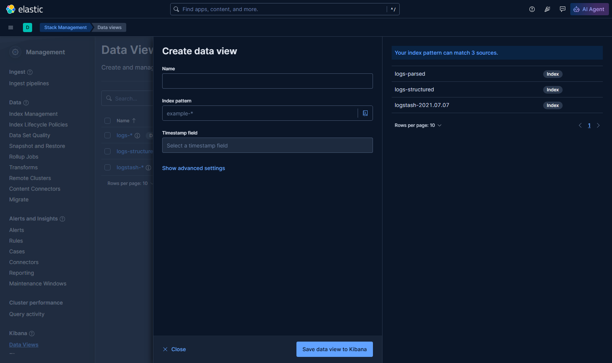
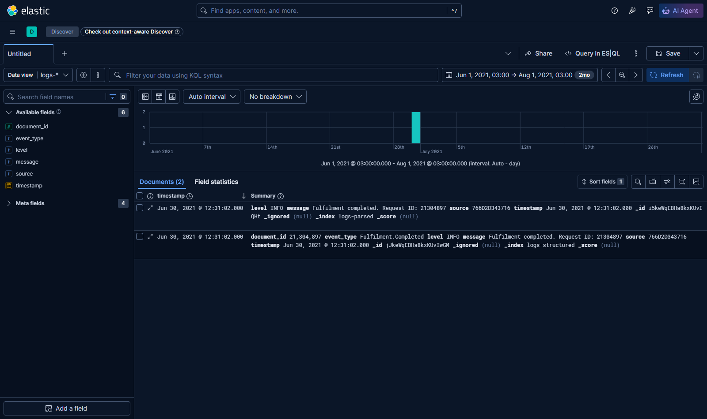
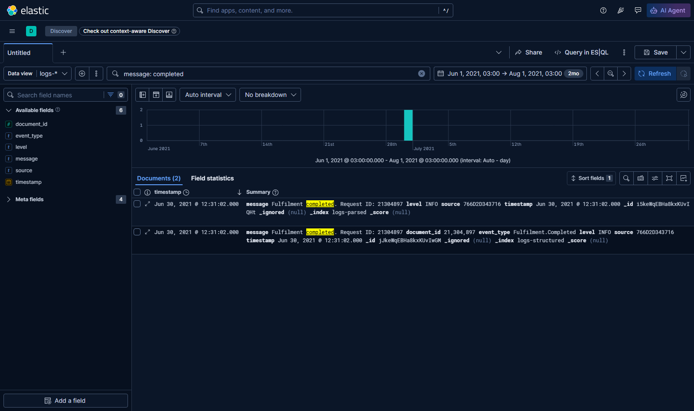

# Kibana

Kibana, Elasticsearch'ün web ön yüzü. Basitleştirilmiş bir sorgu dili veya tam
DSL kullanarak index'ler arasında arama ve filtreleme yapmanıza imkân veriyor.

Aramaları kaydedip sonuçları görselleştirmelere dönüştürebilirsiniz. Kibana'yı
kullanmak oldukça kolay ve ileri kullanıcılar kendi dashboard'larını
kurabiliyor.

<!-- outcomes:auto -->
## Bu lab ne işe yarıyor

`curl` ile log aramak bir olay anında işe yaramıyor. Kibana, Elasticsearch'ün ön kapısı: milyonlarca satırı, kesintiyi açıklayan yirmi satıra indirdiğiniz yer.

**Bu labdan sonra şunları yapabileceksiniz:**

- Logstash besleyen bir kurulumda Kibana'yı Elasticsearch'e karşı çalıştırmak
- konsolu kullanarak doğrudan sorgu çalıştırmak
- indeksler arasında arayıp filtreleyerek tek bir isteği yalıtmak
- bir aramayı kaydedip ekibin geri kalanının yeniden kullanabileceği hale getirmek
<!-- /outcomes:auto -->

<!-- orientation:auto -->
## Bu lab nasıl işliyor

Bunu bir kez okuyun - bu eğitimdeki her lab aynı kurallarla yazıldı.

**Komutları nereye yazacaksınız.** Bir terminal açın ve bu depoyu kopyaladığınız
klasöre gidin. Windows'ta **PowerShell** kullanın (Başlat menüsünde aratın),
macOS veya Linux'ta **Terminal**. Labdaki bütün yollar depo kökünden yazıldı,
yani bir adım aksini söylemedikçe orada kalın.

**`>` ile başlayan satırlar açıklamadır, komut değildir.** Onları yapıştırmayın.
Yalnızca gri kod kutularının içindeki metin yazılır.

**📋 işareti "sıra sizde" demektir.** Onu gördüğünüzde adımı önce kendiniz
deneyin. Hemen altında cevabı saklayan kapalı bir **"Nasıl yapılır?"** oku var;
onu denedikten *sonra* açın, önce değil. Lablar bilerek böyle yazıldı: kendi
çözdüğünüz şeyi hatırlarsınız, yapıştırdığınızı değil.

**Bir komut hata verirse bu normal olabilir.** Bazı adımlar hatanın nasıl
göründüğünü göstermek için bilerek başarısız olur. Bir şeyin bozuk olduğuna
karar vermeden önce komutun üstündeki cümleyi okuyun.

**Takılırsanız** şu sırayla:

1. Komutun üstündeki paragrafı tekrar okuyun - cevap genelde oradadır.
2. **"Nasıl yapılır?"** okunu açın.
3. `hints.md` dosyasını açın, küçük bir yönlendirme verir.
4. `solution.md` dosyasını açın, tam cevap orada. Kullanmak serbest; okumadan
   kopyalamak değil.

**Bitirdiğinizde** en alttaki **Temizlik** bölümünü çalıştırın. Lablar aynı
portları ve container adlarını paylaşıyor; birinden kalan artık diğerini bozar.
<!-- /orientation:auto -->

<!-- prereqs:auto -->
## Başlamadan önce

Süre: yaklaşık 45 dakika.

**Docker Desktop** çalışıyor olmalı. Kontrol edin:

```
docker version
```

Çıktıda bir `Server:` bölümü görüyorsanız hazırsınız. Onun yerine hata
alıyorsanız Docker Desktop'ı başlatın ve balina simgesi hareket etmeyi
bırakana kadar bekleyin.

> Bütün komutları **deponun kök dizininden** çalıştırın; bu labdaki yollar ona göre yazıldı.

## Kaynaklar

- [Kibana Sorgu Dili (KQL)](https://www.elastic.co/guide/en/kibana/current/kuery-query.html) — basit aramalar için
- [Data view oluşturmak](https://www.elastic.co/guide/en/kibana/current/data-views.html) — birden fazla index üzerinde arama yapmak için
- [Discover sekmesini kullanmak](https://www.elastic.co/guide/en/kibana/current/discover.html) — Kibana'da veriyi keşfetme yolunuz

## Kibana'yı Elasticsearch ve Logstash ile çalıştırmak

Tüm ELK yığınını (Elasticsearch, Logstash ve Kibana) container'larda
çalıştıracağız:

- [compose.yml](./compose.yml) — Kibana'yı varsayılan port 5601'de yayınlıyor
  ve Logstash'i yapılandırma ile veri dizinleri bağlanmış halde kuruyor

Container'ları başlatıp Kibana loglarını izleyin:

```
docker compose -f labs/kibana/compose.yml up -d

docker compose -f labs/kibana/compose.yml logs -f kibana
```

Elasticsearch açılırken birkaç hata logu göreceksiniz, ama son log satırı
şuna benzer olacak:

```
{"type":"log","@timestamp":"2021-07-19T05:26:10Z","tags":["info","http","server","Kibana"],"pid":1,"message":"http server running at http://0.0.0.0:5601"}
```

> Bunlar yapılandırılmış loglar. Biçimin kendisi Kibana 8'de değişti (artık
> ECS alanları kullanıyor), dolayısıyla sizdeki satır bununla harfi harfine
> aynı olmayacak — önemli olan JSON olması, düz metin olmaması.

Kibana veriyi saklamak için Elasticsearch'ü kullanıyor; yani birden fazla
Kibana sunucusuyla yatay ölçeklenebilirsiniz ve hepsi aynı veri deposunu
paylaşır.

Index listesini sorgulayın:

```
# log komutundan cikmak icin Ctrl-C

curl 'localhost:9200/_cat/indices?v&expand_wildcards=all'
```

Kibana'nın kendi `.kibana*` index'lerini göreceksiniz. Artık Kibana'yı
kullanmaya hazırız.

> `expand_wildcards=all` önemli: Elasticsearch 8'den beri nokta ile başlayan
> sistem index'leri `_cat/indices` çıktısında varsayılan olarak gizli,
> dolayısıyla düz bir istek burada hiçbir şey göstermiyor.


## Kibana Console'u kullanmak

http://localhost:5601 adresini açın. Birkaç başlangıç kılavuzu içeren bir
karşılama sayfası ve sol üstte bir menü göreceksiniz. Menüyü açıp _Dev Tools_
bölümüne gidin — bu,
[Kibana Console](http://localhost:5601/app/dev_tools#/console)'u açıyor.

Bu, Elasticsearch ile etkileşmenin çok daha hoş bir yolu — hantal curl
komutları olmadan API'ye istek yapabiliyorsunuz, API sözdizimi için otomatik
tamamlama var ve önceki sorgularınız saklanıyor.

Soldaki kutuya yazmaya başlayın:

```
GET /_cat
```

> Otomatik tamamlama, Elasticsearch API'sinde yolunuzu bulmanıza yardım edecek.

📋 Console'u kullanarak Kibana index'i hakkında CAT bilgisi yazdırın.

<details>
  <summary>Biraz yardım lazım mı?</summary>

`indices` uç noktası tek bir index için sorgulanabiliyor:

```
GET /_cat/indices/.kibana*?v&expand_wildcards=all
```

</details><br/>

Bunlar yalnızca basitleştirilmiş sözdizimiyle yapılan HTTP istekleri. HTTP
fiilini ve API yolunu belirtiyorsunuz; JSON biçiminde bir istek gövdesi de
ekleyebiliyorsunuz.

Birkaç yeni döküman oluşturun — bu, ayrıştırılmış bir CSV log kaydı:

```
POST /logs-parsed/_doc
{ 
    "timestamp" : "2021-06-30T09:31:02Z", 
    "level" : "INFO",
    "source" : "766D2D343716",
    "message" : "Fulfilment completed. Request ID: 21304897"
}
```

> Burada `logs-parsed` index adı, `_doc` ise yeni döküman göndermek için
> kullanılan uç nokta.

Her zamanki API yanıtını, index adı ve döküman ID'siyle göreceksiniz. Bir
döküman daha oluşturun, bu kez yapılandırılmış bir log için:

```
POST /logs-structured/_doc
{ 
    "timestamp" : "2021-06-30T09:31:02Z", 
    "level" : "INFO",
    "source" : "766D2D343716",
    "event_type" : "Fulfilment.Completed",
    "document_id" : 21304897,
    "message" : "Fulfilment completed. Request ID: 21304897"
}
```

Otomatik tamamlama istek gövdesinin içinde de çalışıyor — şu satırları yazmaya
başlayın ve DSL'de bir match sorgusunun kurulduğunu göreceksiniz:

- `GET`
- `/l <tab>`
- `/_s <tab> <enter>`
- `{ <enter>`
- `q <tab> <enter>`
- `m <tab>`

Kibana, değerler için şablonlar sunarak sorgu kurmanıza yardım ediyor — şuna
benzer bir şey göreceksiniz:

```
GET /logs-parsed/_search 
{
  "query": {
    "match": {
      "FIELD": "TEXT"
    }
  }
}
```

📋 Yapılandırılmış log index'indeki tüm `Fulfilment.Completed` olaylarını
bulmak için bir match sorgusu çalıştırın.

<details>
  <summary>Biraz yardım lazım mı?</summary>

Şuna benzer bir sorgu kuracaksınız:

```
GET /logs-structured/_search
{
  "query": {
    "match": {
      "event_type": "Fulfilment.Completed"
    }
  }
}
```

Otomatik tamamlama alan adları için de çalışıyor; sorgu üzerinde çalışırken
index'teki mevcut alanların listesini göreceksiniz.

21304897 istek ID'si için tek bir yanıt göreceksiniz.

</details><br/>

Veriyi keşfetmenize yardım eden bir arayüzle sorgulamak çok daha kolay —
console'daki otomatik tamamlama bunun bir parçası, ama Kibana data view'larla
daha da ileri gidiyor.

## Kibana ile arama ve filtreleme

*Data view*'lar, üzerinde arama yapılacak bir veya daha fazla index'i bulmak
için kullanılıyor. Bir data view oluşturduğunuzda Kibana, eşleşen index'lerdeki
tüm dökümanlardaki alanların listesini kuruyor; böylece arama ve filtreleme
seçenekleri sunabiliyor.

Ana menüden _Management > Stack Management_, sonra _Kibana > Data Views_
bölümünü açıp _Create data view_ tıklayın.

> Bunlara Kibana 7'ye kadar **index pattern** deniyordu ve Elastic
> dökümantasyonunun bir kısmı hâlâ eski adı kullanıyor. Kavram birebir aynı.

Şuna benzer bir ekran göreceksiniz:



> Index adı için bir *desen* belirtiyorsunuz; böylece tek bir sorguda bir veya
> daha fazla index üzerinde arama yapabiliyorsunuz.

Logstash alıştırmalarında Elasticsearch'te her günün logları için ayrı bir
index kullanarak, index adında tarihle veri oluşturmuştuk. Bir ayın veya bir
yılın tüm logları üzerinde arama yapacak data view'lar oluşturabilirdik.

İki data view oluşturun:

- `logs-*` — tüm yeni index'lerdeki dökümanlar üzerinde çalışıyor
- `logs-structured` — yalnızca yapılandırılmış log index'iyle eşleşiyor

Her data view için Kibana'nın filtre olarak kullandığı bir _timestamp field_
belirtmeniz gerekiyor. Bu index'lerin ikisinde de kullanabileceğiniz bir
`timestamp` alanı var.

Data view oluşturulduğunda alan listesi gösteriliyor — bu, eşleşen tüm
index'lerdeki tüm dökümanlardaki tüm alanların birleşimi.

Ana menüden _Discover_ sekmesini açın. `logs-*` data view'ınız varsayılan
olarak seçili olmalı, ama hiç sonuç yok. Sağ üstteki takvim simgesine tıklayıp
tarih aralığını Haziran 2021'i kapsayacak şekilde genişletin, örneğin
_Last 1 year_.

Zaman içinde oluşturulan döküman sayısını gösteren bir grafikle birlikte iki
dökümanı da göreceksiniz:



Kibana'nın gerçekten o kadar kolay olup olmadığını görme zamanı :)

📋 Tamamlanmış dökümanlara ait tüm logları bulun. Bunu arayarak veya
filtreleyerek yapabilirsiniz.

<details>
  <summary>Biraz yardım lazım mı?</summary>

Arama kutusunda:

- `completed` terimi tüm alanlarda bulur
- `message: completed` terimi `message` alanında bulur

Ya da _+ Add filter_ tıklayabilirsiniz:

- alan `event_type`, operatör `is` — bir değer yazmanız gerekir
- alan `event_type.keyword`, operatör `is` — bir değer seçebilirsiniz,
  `Fulfilment.Completed` seçin

</details><br/>

> Elasticsearch veriyi farklı alan tiplerinde saklıyor ve Kibana bazı alan
> tipleriyle diğerlerinden daha fazla şey yapabiliyor.

Sayısal alanlarda bir değer aralığına göre filtreleyebilirsiniz. _+Add filter_
tıklayıp `document_id` `is between` seçin — aralığı `21000000` başlangıç ve
`21500000` bitiş olarak girin.

Belirli bir tipte, belirli bir ID aralığında ve log mesajında belirli terimler
içeren dökümanları bulmak için kolayca bir sorgu kurabilirsiniz:




## Lab

Şimdi Kibana'yı gerçek bir arama için kullanacağız.

Logstash, CSV dosyalarını izleyip ayrıştırılmış logları Elasticsearch'e
gönderen bir pipeline ile çalışıyor. `data/fulfilment-20210707.csv` dosyasını
bir index'e yüklemek için Logstash veri dizinine kopyalayın:

```
cp data/fulfilment-20210707.csv labs/kibana/data/
```

Sonra yeni veriyi sorgulamak için Kibana'da bir data view ekleyin ve
_Discover_ sekmesini kullanarak 30.000.000'dan büyük istek ID'leri için kaç
hata logu olduğunu bulun.

> Takıldınız mı? [İpuçlarına](hints.tr.md) bakın veya
> [çözümü](solution.tr.md) inceleyin.

___
<!-- troubleshooting:auto -->
## Takılırsanız

**`Cannot connect to the Docker daemon`** - Docker Desktop çalışmıyor.
Başlatın ve balina simgesi hareket etmeyi bırakana kadar bekleyin.

**`port is already allocated`** - önceki bir labdan kalan konteyner o portu
hâlâ tutuyor. `docker ps` ile neyin çalıştığına bakın, eskisini
`docker rm -f <ad>` ile kaldırın.

**`The container name "/..." is already in use`** - aynı sebep, aynı çözüm:
`docker rm -f <ad>` deyip komutu tekrar çalıştırın.

**Build sırasında `unable to prepare context: path ... not found`** - yanlış
dizindesiniz. Bu labdaki her komut deponun kök dizininde olduğunuzu varsayıyor.

**Çalışmak yerine kullanım metni basan `docker run`** - bu labdaki bazı
komutlar, yanlış argümanın nasıl göründüğünü göstermek için kasıtlı olarak
başarısız oluyor. Bozuk sanmadan önce komutun çevresindeki açıklamayı okuyun.

Hâlâ takılıysanız: aşağıdaki **Cleanup** bölümü her şeyi sıfırlıyor, labı
temiz bir makineyle baştan yapabilirsiniz.


## Temizlik

Bu lab'ın container'larını kaldırın:

```
docker compose -f labs/kibana/compose.yml down
```

> Bu komut yalnızca bu lab'in baslattigi container'lari kaldırır. Tamamen
> temiz bir başlangıç istiyorsanız `docker ps` ile hâlâ çalışan varsa
> görebilirsiniz.
