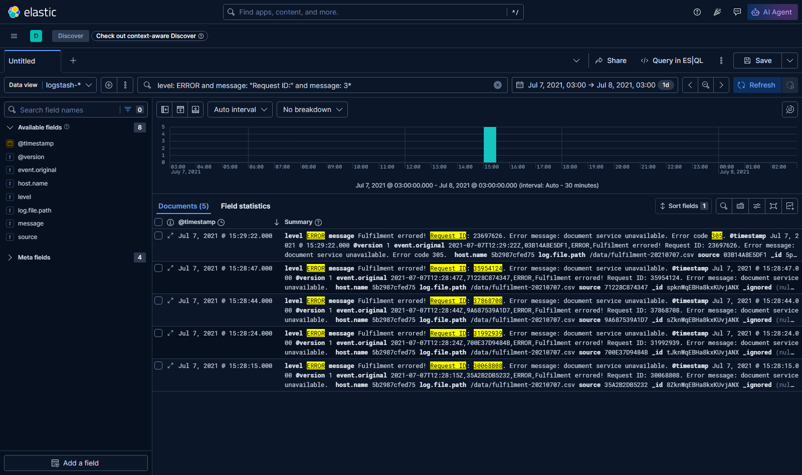
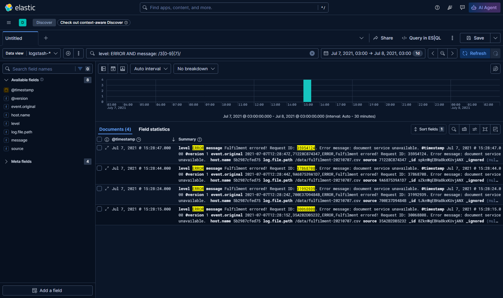

# Lab Çözümü

## Veriyi yüklemek

Veri dosyasını bağlanmış veri klasörüne kopyalayın:

```
cp data/fulfilment-20210707.csv labs/kibana/data/
```

Kibana console'da index'leri listeleyin:

```
GET _cat/indices?v
```

> Log yüklemesi tamamlandığında 86 dökümanlı `logstash-2021.07.07` adında bir
> index göreceksiniz.


Bir data view oluşturun — tam index adını ya da `logstash-*` gibi bir joker
kullanabilirsiniz; timestamp alanı olarak `@timestamp` kullanın.

## Data view'ı sorgulamak

_Discover_ sekmesine geçip yeni data view'ınızı seçin. Son sorgunuzdaki arama
ve filtreler hâlâ orada — onları kaldırın, zaman aralığının 2021-07'yi
kapsadığından emin olun ve _Update_ tıklayın.

Listeden `level` alanına tıklayın; o alan için en çok geçen sonuçları
göreceksiniz. ERROR değerinin yanındaki `+` işaretine tıklayıp onu filtre
olarak ekleyin.

Artık 8 sonuç var ama daha fazla filtreleyemiyorsunuz, çünkü istek ID'sini
içeren sayısal bir alan yok. Yapabileceğiniz en iyi şey, message alanının
"Request ID" ifadesini içerdiği ve "3" ile başlayan bir joker aramak:

```
message: "Request ID:" and message: 3*
```

> 5 sonuç göreceksiniz, ama yalnızca 4'ü istediğimiz:



Joker arama, hata kodu 3 ile başlayan fazladan bir kaydı da buluyor. Bu veri,
isabetli arama için yeterli yapıya sahip değil.

## Lucene sözdizimiyle sorgulamak

KQL düzenli ifade kullanmanıza izin vermiyor, ama Elasticsearch
[Apache Lucene](https://lucene.apache.org) arama motoru üzerine kurulu ve
Kibana'da Lucene aramaları kullanabilirsiniz.

Arama dilini KQL'den Lucene'e değiştirin (arama kutusunun yanındaki _KQL_
kutusuna tıklayıp Kibana Sorgu Dili'ni kapatan düğmeye basın).

Artık yalnızca 30M aralığındaki sayıları bulacak bir düzenli ifadeyle arama
yapabilirsiniz: `message: /3[0-9]{7}/`



> [Lucene sözdizimi](https://www.elastic.co/guide/en/kibana/current/lucene-query.html),
> KQL'den daha zengin bir sorgu dili; KQL ile tam Query DSL arasında hoş bir
> seçenek olabiliyor

## Query DSL ile daha fazla denetim

KQL'deki joker arama doğru cevaba ulaşmanızı sağlamıyor ve Lucene ile düzenli
ifade kullanmanız gerekiyor; ama console'da daha basit bir joker arama
kullanan bir sorgu kurabilirsiniz:

```
GET /logstash-2021.07.07/_search?pretty&size=1
{
  "query": {
    "bool": {
      "must": {
        "wildcard": {
          "message": {
          "value": "3???????"
          }
        }
      },
      "filter": {
        "term": {
          "level.keyword": "ERROR"
        }
      }
    }
  }
}
```

Bu size doğru cevabı verecek, çünkü yalnızca 3 ve ardından 7 karakter geleni
eşleştiriyor; dolayısıyla 305 eşleşmiyor. Query DSL ile çok şey
yapabilirsiniz, ama bu, düzgün yapılandırılmış verinin yerini tutmuyor.


___
> [Alıştırmalara](README.tr.md) dönün.
